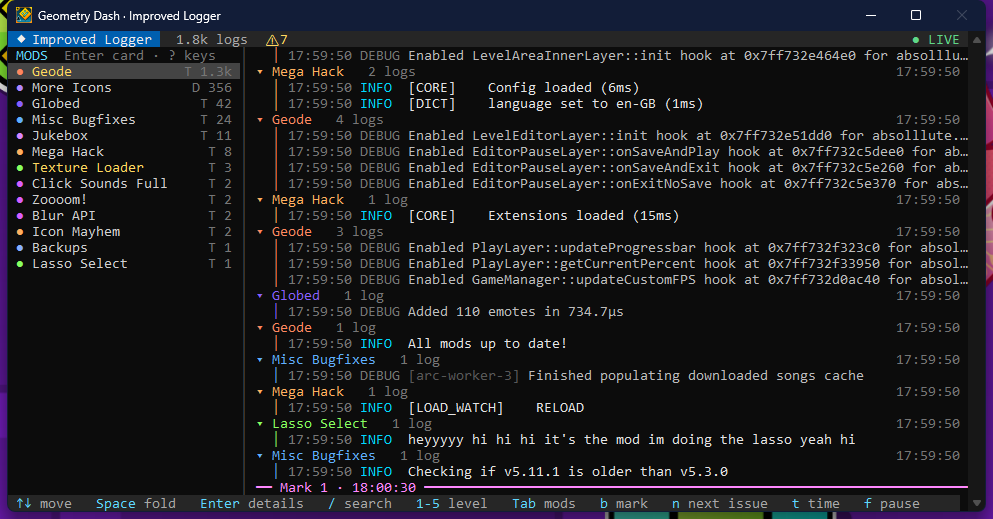

# Improved Logger

A Geode mod that turns Geometry Dash's platform console into an interactive screen for the logs: groups by mod, folds repeated lines, search, level and mod filters, markers, a restart key for the loop of building a mod, and an API to pin values instead of logging them every frame. Windows only.



Turn on **Show Platform Console** in Geode's settings to see the console (on the first launch without it, the mod offers to), and press `?` in it for every key. Log files stay exactly as Geode writes them.

## Install

Download `zhulis.improved-logger.geode` from the [releases](https://github.com/ZhulinskiiDanil/improved-geode-logger/releases) into the `geode/mods` folder of the game, or install it from Zhulis Mods Manager.

## Keys

| Key | What it does |
| --- | --- |
| `↑` `↓` `PgUp` `PgDn` `Home` `End` | Move, scrolling up pauses the live view, `End` goes back to it |
| `Space` `←` `→`, `c` `e` | Fold or unfold a group, all groups |
| `Enter`, `d` | A log in full |
| `/` | Search: `word -word "a phrase" mod:name thread:name level:warn re:regex`, `↑` `↓` for earlier searches |
| `1`–`5` | Show from TRACE, DEBUG, INFO, WARN or ERROR up |
| `Tab`, `m` | The mods list: `Space` hides a mod, `s` shows only it, `a` all, `+` `-` change its log level, `l` turns its logging off, `0` back to everything (levels stay for the next launches), `Enter` opens its card |
| `b`, `Ctrl+Shift+M` in the game | A marker line |
| `n` `N`, `]` `[` | Next / previous warning, error or marker, next / previous group |
| `t` | Time: clock, since the log before, since the group's start, since the marker above |
| `M` | Only what came after the last marker |
| `Shift+R` | Restart the game, a banner says when a `.geode` was rebuilt (a click on it works too) |
| `o` | The crash log of the last session (or a click on its banner) |
| `P` | The mods Geode couldn't load, and why |
| `L` | An older log file of Geode |
| `y` `Ctrl+C` right click, `Y` | Copy the log or the group, as Markdown |
| `E` | Copy every warning and error, by mod, as Markdown |
| `` ` ``, `Ctrl+Shift+L` in the game | Back to the game, back to the console |
| `w`, `W` | Save what the filters show to a file, open the folder |
| `H` | Save it as a page for a browser: groups fold, levels in color, a filter box |
| `v` | Show or hide the watched values |
| `f`, `x`, `?` | Pause, clear the screen, help |

## API for your mod

`include/ImprovedLogger.hpp` lets your mod use the console without depending on Improved Logger: when it isn't installed, `watch` and `mark` do nothing and `Timer` still writes its log.

Add Improved Logger as an optional dependency, Geode gives you the header with it:

```json
"dependencies": {
	"zhulis.improved-logger": {
		"version": ">=v1.3.0",
		"required": false
	}
}
```

Or copy `include/ImprovedLogger.hpp` into your mod.

```cpp
#include <zhulis.improved-logger/include/ImprovedLogger.hpp> // or "ImprovedLogger.hpp" when copied

// A value pinned in the console under your mod's name, updated in place
improved_logger::watch("player x", player->getPositionX());
improved_logger::watch("state", fmt::format("{} / {}", attempts, jumps));
improved_logger::unwatch("state");   // without a name: every value of your mod

// A marker line: "Mark 4 · My Mod: level started"
improved_logger::mark("level started");

// "⏱ load level: 12.40 ms" as a debug log of your mod, when the block ends
{
    improved_logger::Timer timer("load level");
    loadLevel();
}
```

Values are formatted with `fmt`, so anything `fmt::format("{}", value)` accepts works.

## Build

```sh
geode build
```

Needs the Geode SDK (`GEODE_SDK`) and its CLI. The build installs the mod into the game, and the console shows a banner to restart it.
